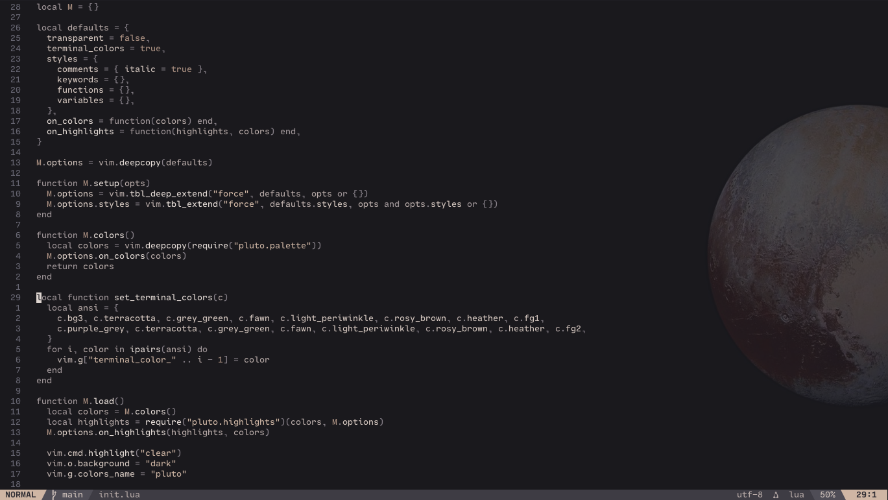
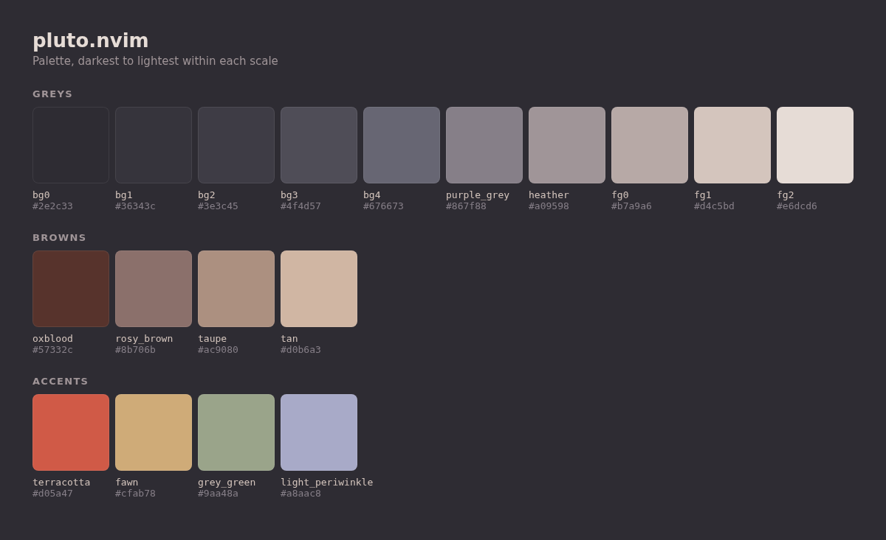

# pluto.nvim

A dark, duotone theme for Neovim inspired by the New Horizons photo of Pluto.



## Install

```lua
vim.pack.add({ "https://github.com/carldaws/pluto.nvim" })
require("pluto").setup()
vim.cmd.colorscheme("pluto")
```

## Options

```lua
require("pluto").setup({
  transparent = false,
  terminal_colors = true,
  styles = {
    comments = { italic = true },
    keywords = {},
    functions = {},
    variables = {},
  },
  on_colors = function(colors) end,
  on_highlights = function(highlights, colors) end,
})
```

`transparent` clears the background of the editor, floating windows and folds, so the terminal shows through.

`on_colors` can change the palette in `lua/pluto/palette.lua` before highlights are built. `on_highlights` can change any highlight group before it is set.

## Plugins

Highlights are tuned for lualine (`theme = "pluto"`, or the default `"auto"`), mini.icons, mini.pick and oil.nvim. Anything that links to the built-in groups will follow along.

## Palette



## Extras

`extras/ghostty/pluto` is a matching Ghostty theme. Copy it to `~/.config/ghostty/themes/pluto` and set `theme = pluto`.
`extras/pluto.png` is the background image seen in the screenshot above.
